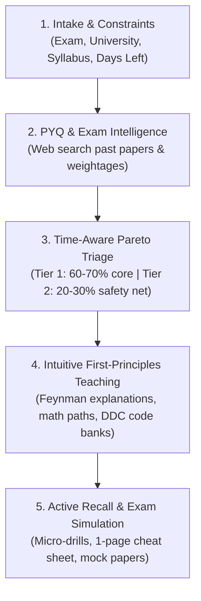

# 🎓 Exam Prep & Curriculum Mastery Skill

This skill transforms raw course syllabi and exam parameters into an optimized, time-budgeted study system backed by past year question (PYQ) intelligence, Pareto 80/20 triage, and Feynman-style intuitive explanations.

---

## Workflow Overview



---

## Step 0: Fetch Official Material First (Deterministic)

Before searching the web, download the official free material with the bundled fetcher:

Each exam is described by a profile (`profiles/<exam>.json`: papers, dates, format, marking, sources). Create one with `python scripts/new_profile.py`; a template ships as `profiles/sample-exam.json`.

```bash
python scripts/fetch_materials.py --profile <exam>            # everything the profile defines
python scripts/fetch_materials.py --profile <exam> --dry-run  # preview without downloading
python scripts/fetch_materials.py --url-file urls.txt         # one-off list of PDF URLs
```

Pluggable source adapters: `ignou-pyq-archive` (IGNOU's official PYQ archive, any programme via "archive_path"), `dspace-community` (any DSpace repository community, e.g. an eGyankosh community), and `url-list` (plain PDF URLs). Safe to re-run: existing files are skipped and failures are listed for retry. Mine the downloaded PYQs to refine paper weights and to grow the profile's MCQ bank. Use web search (Step 2) only for sources the adapters do not cover or to fill gaps.

---

## Step 1: Intake & Constraints Gathering

When the user requests exam preparation, confirm or extract these core parameters:
1. **Exam Name & Subject / Course Title:** (e.g., "Library Classification (BLIS-02)", "Calculus II", "Database Management Systems").
2. **University / Board / Institution:** (e.g., "Delhi University", "IGNOU", "Anna University", "Mumbai University", "State Board").
3. **Exam Date & Available Time:**
   - Specific date (e.g., `2026-12-15`) or time duration (e.g., "1 month left", "10 days left", "48 hours crunch").
   - Daily study hours available (e.g., `3 hours/day`).
4. **Study Material / Syllabus:**
   - Provided list of chapters, pasted syllabus, uploaded notes, or textbook table of contents.
5. **Target Score Goal:**
   - *Emergency Pass* (40-50%), *Safe First Class* (60-70%), *Distinction / Rank* (80-100%).

*If any parameter is missing, make reasonable inferences based on standard university curricula and ask a quick clarifying question.*

---

## Step 2: PYQ & Exam Intelligence Gathering

If Step 0 already downloaded official PYQs, mine those PDFs directly. Otherwise use the `search_web` tool to find past year question papers (PYQs) and university marking schemes.

### Targeted Search Patterns:
Refer to [pyq-search-strategies.md](./references/pyq-search-strategies.md) for full query formulas.
- `"[University Name]" "[Course/Subject Name]" previous year question papers filetype:pdf`
- `"[Course Code]" question paper "[University Name]"`
- `"[Subject Name]" syllabus weightage marking scheme "[University Name]"`

### Intelligence Extraction Checklist:
1. **Paper Structure & Compulsory Sections:**
   - Does the paper have a compulsory "Part A" (short 2-mark definitions)?
   - Is there internal choice in "Part B" (e.g., "Answer 5 out of 8")?
2. **The "Golden 20%" Recurring Topics:**
   - Identify the 3–4 modules or question archetypes that appear in almost every exam cycle.
3. **Question Formulation Archetypes:**
   - Numerical problems vs. theoretical derivations vs. classification exercises vs. comparison essays.

---

## Step 3: Time-Aware Pareto Curriculum Curation

Execute the curriculum triage logic (or invoke `scripts/exam_planner.py`):

```bash
# Single exam, flat syllabus:
python scripts/exam_planner.py --exam-date <YYYY-MM-DD> --daily-hours <HOURS>

# Any exam profile (any number of papers, each with its own date):
python scripts/exam_planner.py --profile <exam> --daily-hours 3.0
```

Multi-exam mode plans each course against its own exam date, splits the shared study pool across courses, and prints a day-by-day calendar (earliest exam scheduled first, exam days kept free). Units in the profile may carry `"tier_hint": 1|2|3` to pin a known high-yield unit into a tier.

Refer to [curriculum-triage.md](./references/curriculum-triage.md) for the mathematical allocation rules.

### The 3-Tier Rule (Never skip entire chapters!):
1. **Tier 1: Core High-Yield (Guarantees 60% - 70% of Marks)**
   - Top 20-30% chapters that carry 60%+ of the total weightage.
   - **Protocol:** Deep mastery, complete conceptual foundation, step-by-step problem templates, every past exam question solved.
   - **Allocation:** 60% of total study hours.
2. **Tier 2: The High-Leverage Safety Net (Buffer for 20% - 30% of Marks)**
   - The remaining 70% of the syllabus. **These are NEVER ignored.**
   - **Protocol:** Condense each chapter into **The Core 3**:
     - 3 essential definitions (for Section A short questions).
     - 2 core formulas / classification rules (for standard plug-and-chug problems).
     - 1 intuitive real-world analogy.
   - **Result:** If an exam question appears on these chapters, the student will confidently answer standard questions or secure 70-80% partial marks.
   - **Allocation:** 30% of total study hours.
3. **Tier 3: Bonus / Quick Skim (< 10% of Marks)**
   - Niche edge cases and obscure derivations. Summarized in 1-page formula & keyword sheet.
   - **Allocation:** 10% of study hours (0% during emergency crunch).

---

## Step 4: Intuitive "Feynman & First-Principles" Teaching

Follow the detailed teaching guides in [pedagogy-guides.md](./references/pedagogy-guides.md).

### A. For Mathematics & Quantitative Subjects:
1. **Intuitive Hook:** Explain the physical meaning before any algebra (e.g., "What does this formula measure in real life?").
2. **The Easiest Path:** Minimalist formula breakdown with every symbol translated into plain English.
3. **Step-by-Step Benchmark Problem:**
   - Step 1: Identify given inputs and target variable.
   - Step 2: Select governing equation.
   - Step 3: Clean arithmetic substitution without skipping steps.
4. **"Exam Trap" Alert:** Highlight the #1 common algebraic error that causes students to lose marks.

### B. For Classification Systems, Codes & Taxonomies:
*(e.g., Dewey Decimal Classification (DDC), Colon Classification, Accounting Standards, Law Sections, Medical Codes)*
1. **The "Must-Memorize Code Bank":**
   - Extract the top 10–20 codes that represent 90% of exam questions.
   - Attach catchy visual/phonetic mnemonics (e.g., for DDC: `000 = Computer/Digital Bits`, `100 = 1 Mind / Philosophy`, `200 = 2 Hands Praying / Religion`, `300 = Society / 3's a crowd`, `600 = 6 gears in engine / Technology`).
2. **The 3-Step Decision Algorithm:**
   - Step 1: Identify the primary discipline / main class (hundreds).
   - Step 2: Drill down to division and section (tens and units).
   - Step 3: Append standard subdivisions (tables, geography `.09`, form `.03`).
3. **Rapid Practice Drills:**
   - Provide 3–5 sample titles or scenarios, show the exact classification breakdown, and explain *why*.

### C. For Descriptive & Theory Subjects:
- Structure all answers in the **Examiner-Friendly 5-Point Format**:
  1. Crisp 1-sentence definition.
  2. 3–4 bullet points with bold keywords.
  3. Clean text-based or mermaid diagram.
  4. Structured 2-column comparison table (when differentiating concepts).
  5. 1 real-world case study or practical application.

---

## Step 5: Active Recall, Cheat Sheets & Exam Simulation

Reinforce learning with high-impact revision artifacts:
1. **MCQ Drills & Mock Exams:** use the quiz engine (works for MCQ/OMR papers and flashcard self-grading for descriptive ones), which shuffles options, scores attempts, and logs progress to `progress.json`:

   ```bash
   python scripts/mcq_quiz.py --profile <exam> --course <CODE> --count 15   # drill with feedback
   python scripts/mcq_quiz.py --profile <exam> --course <CODE> --mock       # exam simulation
   python scripts/mcq_quiz.py --report                                     # progress so far
   ```

2. **End-of-Session Micro-Drills:** 3 to 5 rapid active-recall questions to test retention immediately.
3. **1-Page Master Cheat Sheet:** Generate a dense reference sheet based on [cheat-sheet-template.md](./templates/cheat-sheet-template.md) containing only high-frequency formulas, codes, definitions, and trap alerts.
4. **Predicted Mock Paper:** Generate a full simulated test based on [mock-paper-template.md](./templates/mock-paper-template.md) matching the university's marking scheme and question structure.
