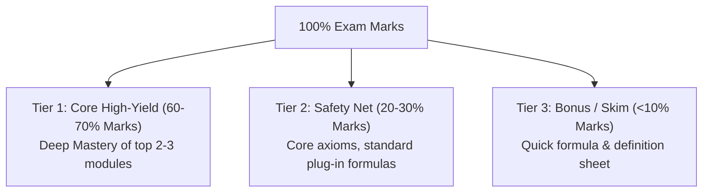

# 🎯 Curated Exam Preparation Plan: [Course / Subject Name]

**Institution / Board:** [University / Board Name]  
**Target Exam Date:** [YYYY-MM-DD] (`[N] Days Remaining`)  
**Target Goal:** [e.g., Safe 60% First Class / 85%+ Distinction]  
**Daily Study Budget:** [e.g., 3 Hours / Day]  

---

## 🧭 Strategic Blueprint: The Pareto Triage
> [!IMPORTANT]
> **The 80/20 Rule Applied:** In university exams, ~70% of marks consistently come from ~30% of the syllabus. We focus deep energy on the **High-Yield Tier 1** to lock down the passing and scoring threshold, while systematically arming you with the **Tier 2 Safety Net** (core principles & standard models) so no question leaves you stranded.

---

## 🏆 Tier 1: Core High-Yield Topics (Must-Master)
*Guarantees 60% - 70% of total exam score*

### 1. [Topic / Module 1 Name] (~[Weight]% Weightage)
- **Why it's High-Yield:** [Past exam frequency: e.g. Appeared in 5 out of last 5 question papers].
- **Core Archetypes Examined:**
  - [Archetype A, e.g. 10-mark derivation / long classification problem]
  - [Archetype B, e.g. Comparison between X and Y]
- **Target Hours:** `[X] Hours`
- **Mastery Checklist:**
  - [ ] Plain-English intuition understood
  - [ ] 3 Step-by-step benchmark problems solved without looking at solutions
  - [ ] Standard diagram/table memorized

### 2. [Topic / Module 2 Name] (~[Weight]% Weightage)
- *(Same structure as above)*

---

## 🛡️ Tier 2: Foundation & Safety Net Topics (Never Ignored!)
*Provides a 20% - 30% score buffer without syllabus overload*

For these chapters, you do **not** need to read 200 pages of textbook. You master the **Core 3**:
1. **The 3 Essential Definitions:** (For 2-mark Section A questions).
2. **The 2 Core Formulas / Rules:** (For standard plug-and-play questions).
3. **1 Real-world Analogy or Application:** (To write coherent explanatory paragraphs).

| Topic / Chapter | Weight | Target Hours | The 3 Core Takeaways to Memorize |
| :--- | :---: | :---: | :--- |
| **[Chapter A]** | ~15% | `[Y] hrs` | 1. [Core Def]   2. [Main Formula/Rule]   3. [Key Example] |
| **[Chapter B]** | ~15% | `[Y] hrs` | 1. [Core Def]   2. [Main Formula/Rule]   3. [Key Example] |

---

## 📅 Timeline & Daily Execution Schedule

| Day / Date Range | Focus Tier | Chapters / Deliverables | Daily Hours | Milestone Check |
| :--- | :---: | :--- | :---: | :--- |
| **Days 1 - [N]** | Tier 1 | [Topic 1 Deep Dive + PYQ Drills] | `3.0` | Solve 2022 & 2023 exam questions |
| **Days [N+1] - [M]** | Tier 1 | [Topic 2 Deep Dive + Model Answers] | `3.0` | Diagram & derivation benchmark |
| **Days [M+1] - [P]** | Tier 2 | [Rapid Safety Net Foundations] | `2.5` | Flashcard & definition mastery |
| **Final 2 Days** | Review | [Full Mock Paper + Cheat Sheet Walkthrough] | `3.5` | Timed 3-hour mock under exam conditions |
